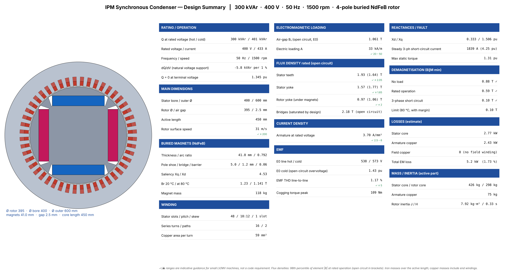
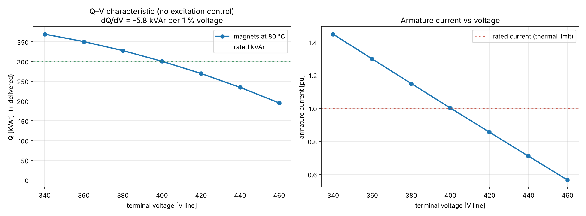
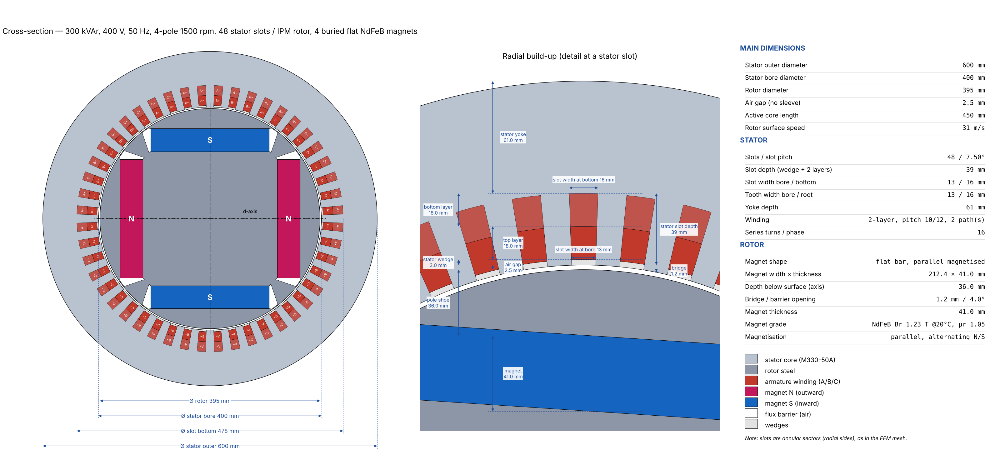
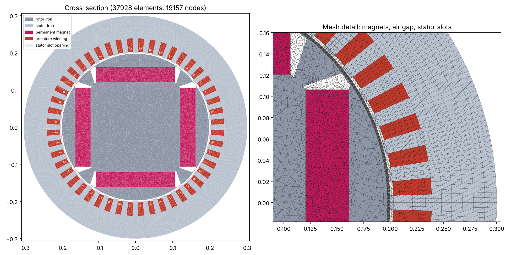
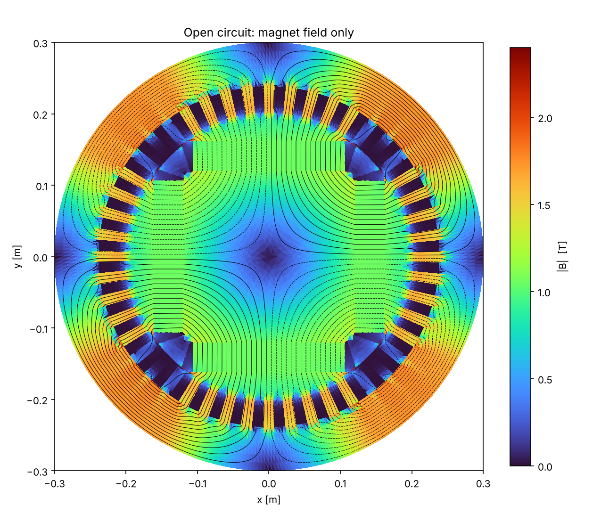
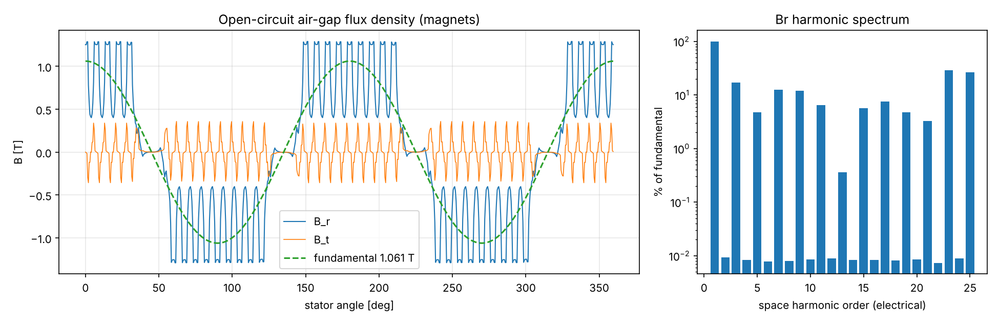
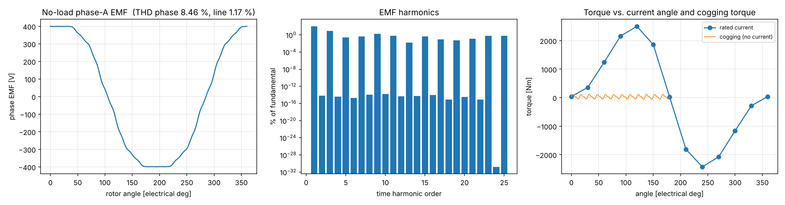
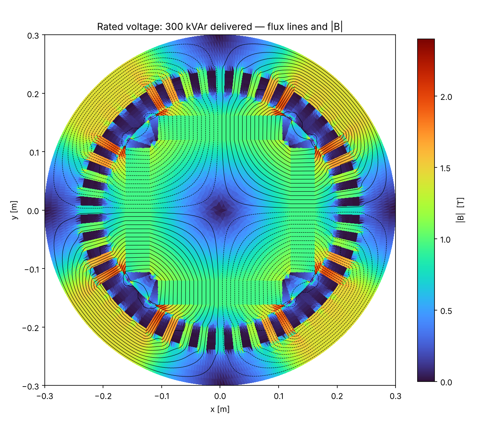
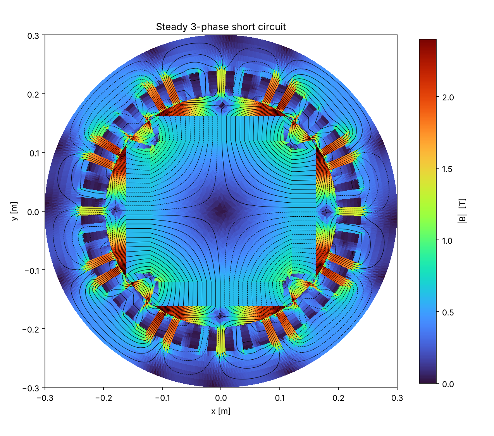
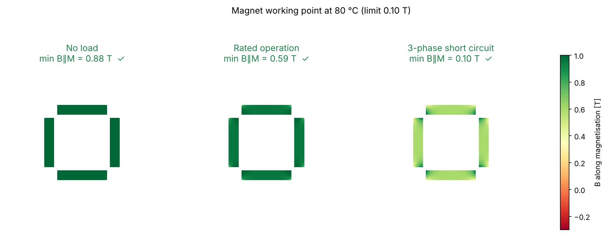

# IPM Synchronous Condenser — 2-D Electromagnetic FEM Study

Machine: **300 kVAr, 400 V, 50 Hz, 4-pole, 1500 rpm**,
buried (interior) radially magnetised NdFeB arc magnets with pole shoes and flux barriers, no field winding.
Nonlinear magnetostatic Az FEM with linear magnets (recoil μr = 1.05),
37928 elements. Solver: SciPy SuperLU. Runtime 291 s.

## 1. Key consequence of permanent-magnet excitation

The EMF is fixed by the magnets, so **reactive power cannot be set by excitation**; it follows the
terminal voltage: Q ≈ 3·V·(E − V)/Xs.

| Item | Value |
|---|---|
| Q at rated voltage, magnets 80 °C | **300 kVAr** (I = 433.6 A, 1.00 pu) |
| Q at rated voltage, cold magnets 20 °C | 401 kVAr — current 1.34 pu ⚠ (thermal: cold start-up) |
| Natural voltage support dQ/dV | -5.8 kVAr per 1 % voltage (Q rises when V falls) |
| Terminal voltage for Q = 0 | 1.345 pu (538 V) — absorbs vars only above this |

| V [pu] | V [V] | I [A] | I [pu] | Q [kVAr] |
|---|---|---|---|---|
| 0.85 | 340 | 626.8 | 1.45 | 369.1 |
| 0.90 | 360 | 561.8 | 1.30 | 350.3 |
| 0.95 | 380 | 497.4 | 1.15 | 327.4 |
| 1.00 | 400 | 433.6 | 1.00 | 300.4 |
| 1.05 | 420 | 370.3 | 0.86 | 269.4 |
| 1.10 | 440 | 307.5 | 0.71 | 234.3 |
| 1.15 | 460 | 245.0 | 0.57 | 195.2 |

## 2. Main dimensions

| Item | Value |
|---|---|
| Stator outer / bore diameter | 600 / 400 mm |
| Rotor diameter / magnet seat diameter | 395.0 / 241.0 mm |
| Air gap (no sleeve) | 2.5 mm |
| Pole shoe / bridge / flux barrier | 5.0 mm / 1.2 mm / 0.06 of pole pitch each side |
| Saliency Xq/Xd | 4.53 |
| Active length | 450 mm |
| Magnets | 4 × NdFeB, 41.0 mm thick, arc ratio 0.792, Br 1.23 T (20 °C) → 1.141 T (80 °C), mass 117.6 kg |
| Stator | 48 slots, double layer, pitch 10/12, 16 series turns, skew 1 slot |

## 3. Open circuit (magnets only)

| Result | Value |
|---|---|
| E0 line, 80 °C / 20 °C | 538 V (1.345 pu) / 573 V (1.433 pu) |
| Air-gap B1 | 1.061 T |
| EMF THD line-to-line / phase | 1.17 % / 8.46 % |
| Peak cogging torque | 109.1 Nm |

Open-circuit voltage after disconnection can reach **1.43 pu** (cold magnets).

## 4. Reactances, short circuit and demagnetisation

| Item | Value |
|---|---|
| Xd / Xq (incl. end leakage 0.06 pu) | 0.333 / 1.506 pu |
| Steady 3-phase short-circuit current | 1839 A (4.25 pu) |
| Max static torque at rated current | 1.31 pu |
| Min B along magnetisation: no load / rated / short circuit | 0.88 ✓ / 0.59 ✓ / 0.10 ✓ T (limit 0.10 T at 80 °C) |

## 5. Losses (estimate)

| Component | Value |
|---|---|
| Stator core | 2.77 kW |
| Armature copper (Rph = 4.30 mΩ, J = 3.70 A/mm²) | 2.43 kW |
| Field copper | 0 (no field winding) |
| **Total electromagnetic** | **5.20 kW (1.73 %)** |

Magnet eddy-current, friction/windage, bearing and stray losses are not included.

## 6. Modelling assumptions

* 2-D magnetostatic; end-winding leakage as a fixed reactance; stator skew applied analytically.
* Magnets: linear recoil line, radial magnetisation, Br temperature coefficient -0.12 %/K.
  Demagnetisation is judged by the minimum flux density along the magnetisation versus a knee limit.
* Steady-state short circuit only; the sub-transient peak current is higher (transient analysis needed).
* Purely reactive operation (current on the d-axis); resistance neglected for the voltage balance.
