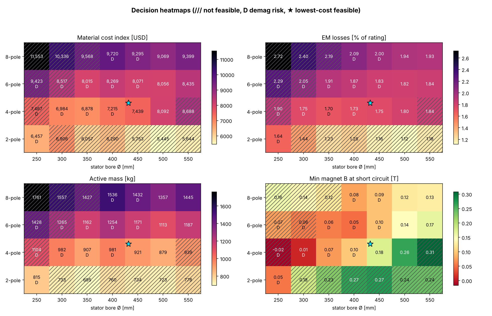
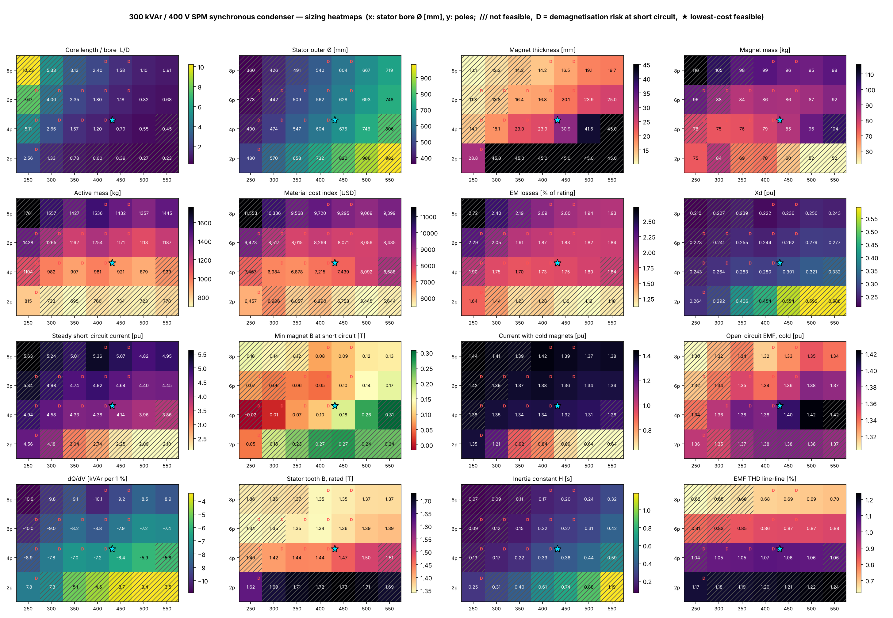

# Sizing study — 300 kVAr / 400 V SPM synchronous condenser

28 cases: poles [2, 4, 6, 8], stator bore 250, 300, 350, 400, 450, 500, 550 mm. Demagnetisation limit 0.10 T.

Feasibility: L_over_D in (0.3, 3.0), B_tooth_rated in (None, 2.0), I_cold_pu in (None, 1.6); magnets sized for rated kVAr.

**Lowest material cost feasible design:** 4-pole, Ø bore 450 mm, L = 355 mm, OD 676 mm, magnets 30.9 mm (85 kg), losses 1.75 %, cost index 7,439 USD, demag OK.

| poles | Ø bore | L | L/D | OD | h_m | magnet kg | loss % | Xd | I_sc pu | B_sc T | cost USD | feasible | demag |
|---|---|---|---|---|---|---|---|---|---|---|---|---|---|
| 2 | 550 | 125 | 0.23 | 982 | 45.0 | 52 | 1.18 | 0.588 | 2.10 | 0.24 | 5,644 | ✗ Q < rated even with 45 mm magnets; L_over_D < 0.3 | ✓ |
| 2 | 500 | 137 | 0.27 | 906 | 45.0 | 52 | 1.12 | 0.592 | 2.09 | 0.24 | 5,445 | ✗ Q < rated even with 45 mm magnets; L_over_D < 0.3 | ✓ |
| 2 | 450 | 178 | 0.39 | 820 | 45.0 | 60 | 1.16 | 0.554 | 2.25 | 0.27 | 5,753 | ✗ Q < rated even with 45 mm magnets | ✓ |
| 2 | 400 | 240 | 0.60 | 732 | 45.0 | 70 | 1.28 | 0.454 | 2.74 | 0.27 | 6,290 | ✗ Q < rated even with 45 mm magnets | ✓ |
| 2 | 350 | 274 | 0.78 | 658 | 45.0 | 69 | 1.23 | 0.406 | 3.04 | 0.23 | 6,057 | ✗ Q < rated even with 45 mm magnets | ✓ |
| 2 | 300 | 400 | 1.33 | 570 | 45.0 | 84 | 1.44 | 0.292 | 4.18 | 0.18 | 6,906 | ✗ Q < rated even with 45 mm magnets | ✓ |
| 2 | 250 | 639 | 2.56 | 480 | 28.8 | 75 | 1.64 | 0.264 | 4.56 | 0.05 | 6,457 | ✓ | ⚠ |
| 4 | 550 | 249 | 0.45 | 806 | 45.0 | 104 | 1.84 | 0.332 | 3.86 | 0.31 | 8,688 | ✗ Q < rated even with 45 mm magnets | ✓ |
| 4 | 500 | 274 | 0.55 | 746 | 41.6 | 96 | 1.80 | 0.321 | 3.96 | 0.26 | 8,092 | ✓ | ✓ |
| 4 | 450 | 355 | 0.79 | 676 | 30.9 | 85 | 1.75 | 0.301 | 4.14 | 0.18 | 7,439 | ✓ | ✓ |
| 4 | 400 | 479 | 1.20 | 604 | 23.9 | 79 | 1.73 | 0.280 | 4.38 | 0.10 | 7,215 | ✓ | ⚠ |
| 4 | 350 | 548 | 1.57 | 547 | 23.0 | 76 | 1.70 | 0.283 | 4.33 | 0.07 | 6,878 | ✓ | ⚠ |
| 4 | 300 | 799 | 2.66 | 474 | 18.1 | 75 | 1.75 | 0.264 | 4.58 | 0.01 | 6,984 | ✓ | ⚠ |
| 4 | 250 | 1279 | 5.11 | 400 | 14.1 | 78 | 1.90 | 0.243 | 4.94 | -0.02 | 7,467 | ✗ L_over_D > 3.0 | ⚠ |
| 6 | 550 | 374 | 0.68 | 748 | 25.0 | 92 | 1.84 | 0.277 | 4.45 | 0.17 | 8,435 | ✓ | ✓ |
| 6 | 500 | 411 | 0.82 | 693 | 23.9 | 87 | 1.82 | 0.279 | 4.40 | 0.14 | 8,056 | ✓ | ✓ |
| 6 | 450 | 533 | 1.18 | 628 | 20.1 | 86 | 1.83 | 0.262 | 4.64 | 0.10 | 8,071 | ✓ | ⚠ |
| 6 | 400 | 719 | 1.80 | 562 | 16.8 | 86 | 1.87 | 0.244 | 4.92 | 0.05 | 8,269 | ✓ | ⚠ |
| 6 | 350 | 822 | 2.35 | 509 | 16.4 | 84 | 1.91 | 0.255 | 4.74 | 0.06 | 8,015 | ✓ | ⚠ |
| 6 | 300 | 1199 | 4.00 | 442 | 13.8 | 88 | 2.05 | 0.241 | 4.98 | 0.06 | 8,517 | ✗ L_over_D > 3.0 | ⚠ |
| 6 | 250 | 1918 | 7.67 | 373 | 11.3 | 96 | 2.29 | 0.223 | 5.34 | 0.07 | 9,423 | ✗ L_over_D > 3.0 | ⚠ |
| 8 | 550 | 498 | 0.91 | 719 | 19.7 | 98 | 1.93 | 0.243 | 4.95 | 0.13 | 9,399 | ✓ | ✓ |
| 8 | 500 | 548 | 1.10 | 667 | 19.1 | 95 | 1.94 | 0.250 | 4.82 | 0.12 | 9,069 | ✓ | ✓ |
| 8 | 450 | 710 | 1.58 | 604 | 16.5 | 96 | 2.00 | 0.236 | 5.07 | 0.09 | 9,295 | ✓ | ⚠ |
| 8 | 400 | 959 | 2.40 | 540 | 14.2 | 99 | 2.09 | 0.222 | 5.36 | 0.08 | 9,720 | ✓ | ⚠ |
| 8 | 350 | 1096 | 3.13 | 491 | 14.2 | 98 | 2.19 | 0.239 | 5.01 | 0.12 | 9,568 | ✗ L_over_D > 3.0 | ✓ |
| 8 | 300 | 1598 | 5.33 | 426 | 12.2 | 105 | 2.40 | 0.227 | 5.24 | 0.14 | 10,336 | ✗ L_over_D > 3.0 | ✓ |
| 8 | 250 | 2557 | 10.23 | 360 | 10.1 | 116 | 2.72 | 0.210 | 5.63 | 0.16 | 11,553 | ✗ L_over_D > 3.0 | ✓ |
