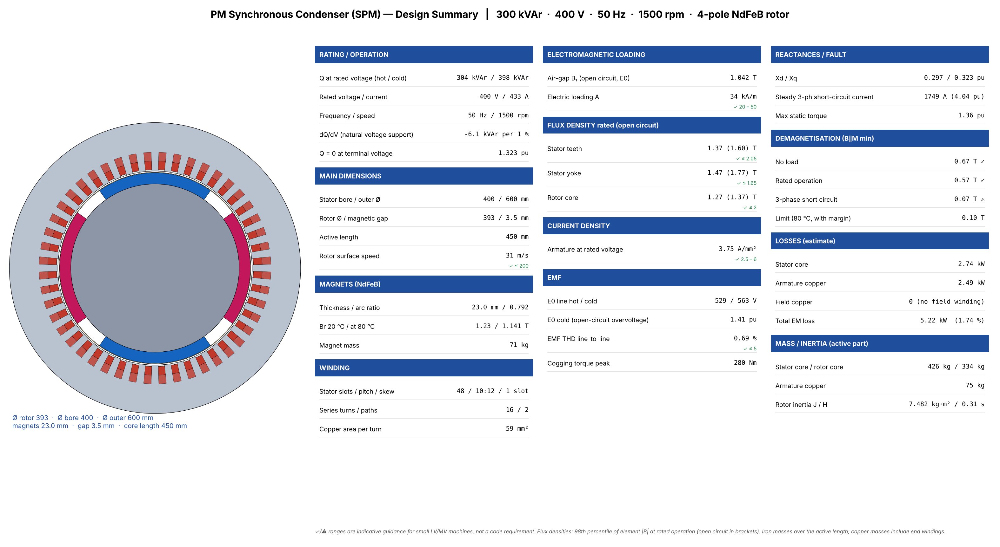
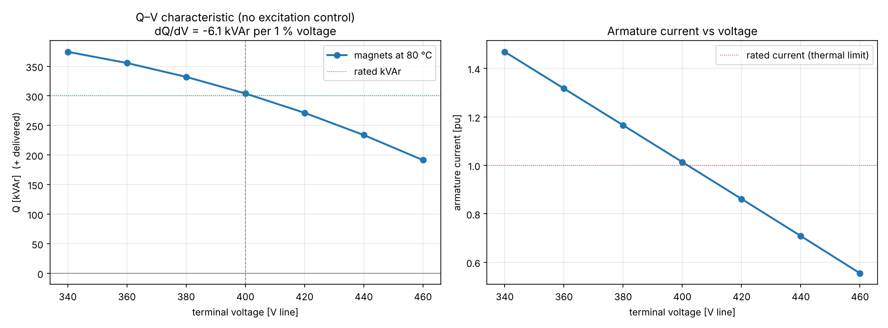
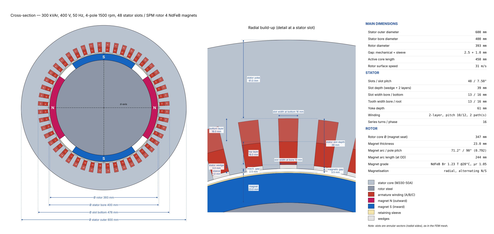
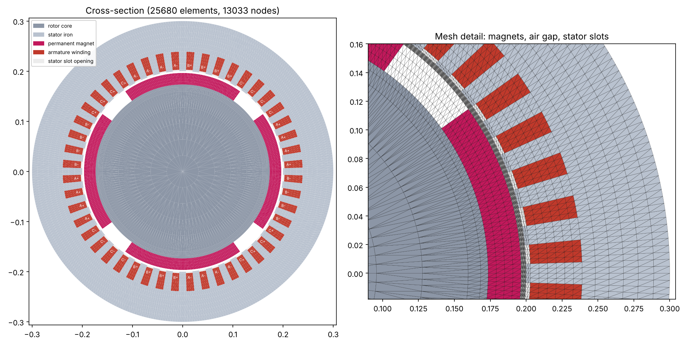
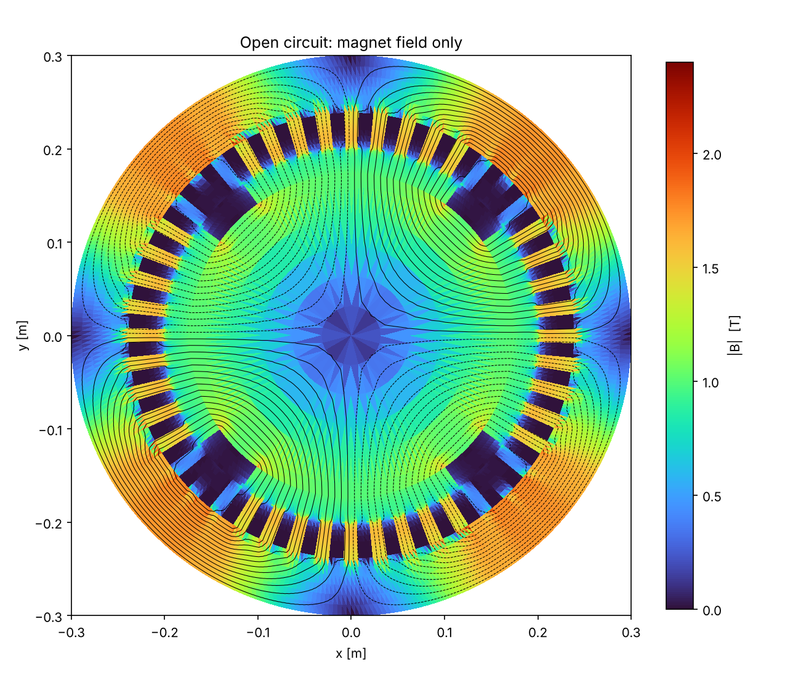
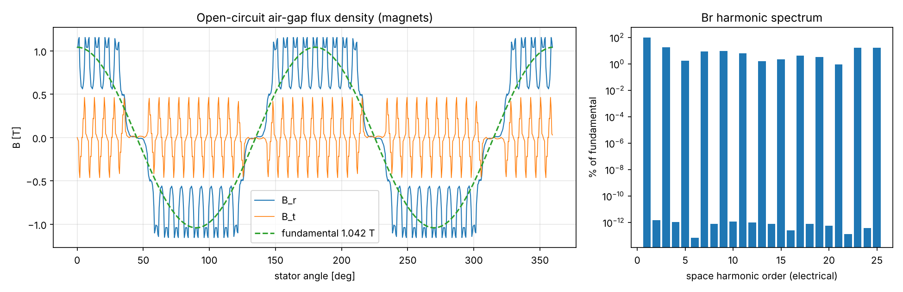
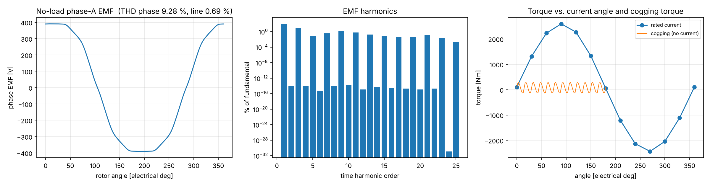
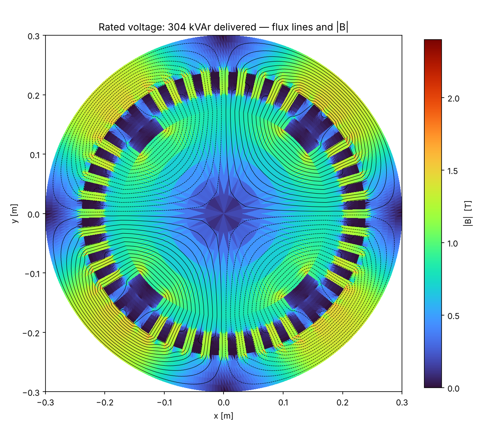
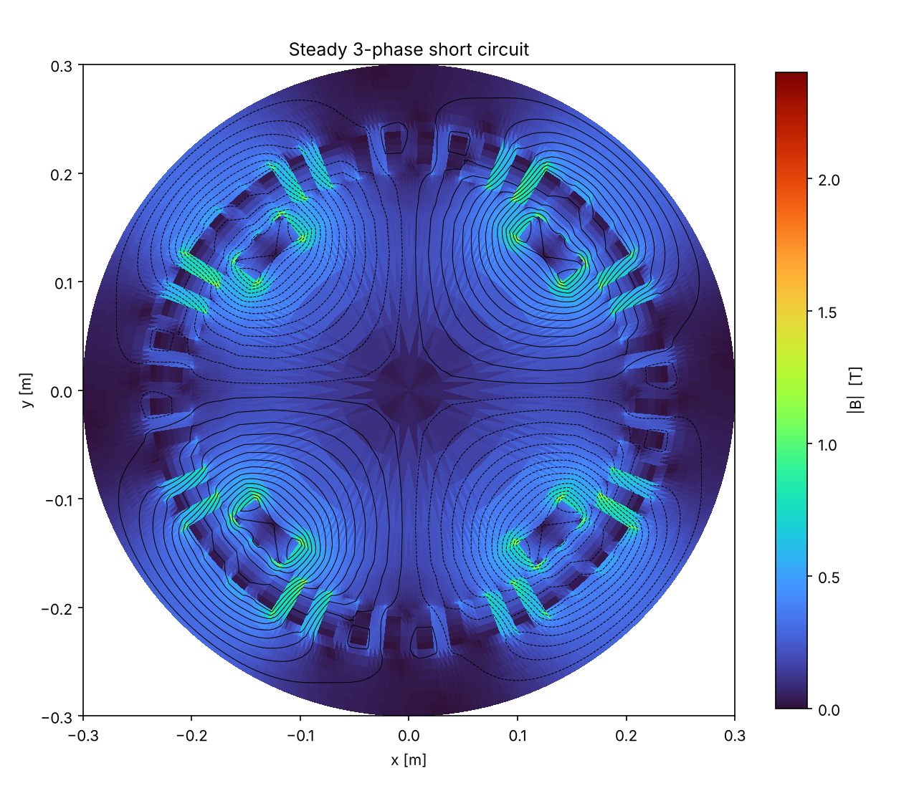
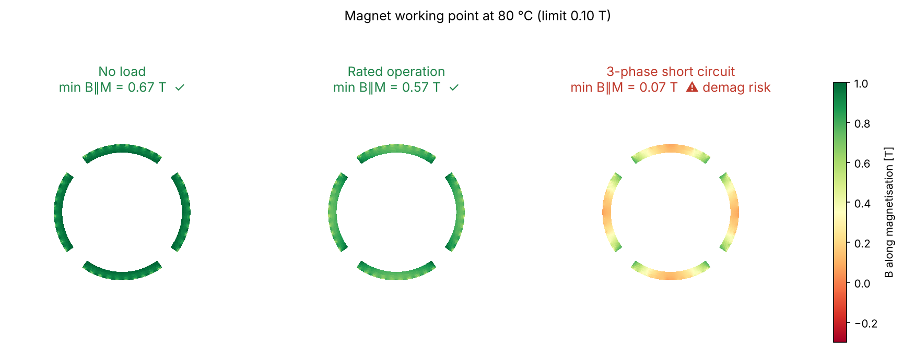

# PM Synchronous Condenser (SPM rotor) — 2-D Electromagnetic FEM Study

Machine: **300 kVAr, 400 V, 50 Hz, 4-pole, 1500 rpm**,
surface-mounted radially magnetised NdFeB magnets, no field winding.
Nonlinear magnetostatic Az FEM with linear magnets (recoil μr = 1.05),
25680 elements. Solver: SciPy SuperLU. Runtime 88 s.

## 1. Key consequence of permanent-magnet excitation

The EMF is fixed by the magnets, so **reactive power cannot be set by excitation**; it follows the
terminal voltage: Q ≈ 3·V·(E − V)/Xs.

| Item | Value |
|---|---|
| Q at rated voltage, magnets 80 °C | **304 kVAr** (I = 438.9 A, 1.01 pu) |
| Q at rated voltage, cold magnets 20 °C | 398 kVAr — current 1.33 pu ⚠ (thermal: cold start-up) |
| Natural voltage support dQ/dV | -6.1 kVAr per 1 % voltage (Q rises when V falls) |
| Terminal voltage for Q = 0 | 1.323 pu (529 V) — absorbs vars only above this |

| V [pu] | V [V] | I [A] | I [pu] | Q [kVAr] |
|---|---|---|---|---|
| 0.85 | 340 | 636.0 | 1.47 | 374.5 |
| 0.90 | 360 | 570.3 | 1.32 | 355.6 |
| 0.95 | 380 | 504.7 | 1.17 | 332.2 |
| 1.00 | 400 | 438.9 | 1.01 | 304.1 |
| 1.05 | 420 | 373.0 | 0.86 | 271.3 |
| 1.10 | 440 | 306.8 | 0.71 | 233.8 |
| 1.15 | 460 | 240.2 | 0.55 | 191.4 |

## 2. Main dimensions

| Item | Value |
|---|---|
| Stator outer / bore diameter | 600 / 400 mm |
| Rotor diameter (magnet OD) / core diameter | 393.0 / 347.0 mm |
| Magnetic gap = mechanical + sleeve | 3.5 = 2.5 + 1.0 mm |
| Active length | 450 mm |
| Magnets | 4 × NdFeB, 23.0 mm thick, arc ratio 0.792, Br 1.23 T (20 °C) → 1.141 T (80 °C), mass 71.4 kg |
| Stator | 48 slots, double layer, pitch 10/12, 16 series turns, skew 1 slot |

## 3. Open circuit (magnets only)

| Result | Value |
|---|---|
| E0 line, 80 °C / 20 °C | 529 V (1.323 pu) / 563 V (1.409 pu) |
| Air-gap B1 | 1.042 T |
| EMF THD line-to-line / phase | 0.69 % / 9.28 % |
| Peak cogging torque | 280.3 Nm |

Open-circuit voltage after disconnection can reach **1.41 pu** (cold magnets).

## 4. Reactances, short circuit and demagnetisation

| Item | Value |
|---|---|
| Xd / Xq (incl. end leakage 0.06 pu) | 0.297 / 0.323 pu |
| Steady 3-phase short-circuit current | 1749 A (4.04 pu) |
| Max static torque at rated current | 1.36 pu |
| Min B along magnetisation: no load / rated / short circuit | 0.67 ✓ / 0.57 ✓ / 0.07 ⚠ T (limit 0.10 T at 80 °C) |

## 5. Losses (estimate)

| Component | Value |
|---|---|
| Stator core | 2.74 kW |
| Armature copper (Rph = 4.30 mΩ, J = 3.75 A/mm²) | 2.49 kW |
| Field copper | 0 (no field winding) |
| **Total electromagnetic** | **5.22 kW (1.74 %)** |

Magnet eddy-current, friction/windage, bearing and stray losses are not included.

## 6. Modelling assumptions

* 2-D magnetostatic; end-winding leakage as a fixed reactance; stator skew applied analytically.
* Magnets: linear recoil line, radial magnetisation, Br temperature coefficient -0.12 %/K.
  Demagnetisation is judged by the minimum flux density along the magnetisation versus a knee limit.
* Steady-state short circuit only; the sub-transient peak current is higher (transient analysis needed).
* Purely reactive operation (current on the d-axis); resistance neglected for the voltage balance.
