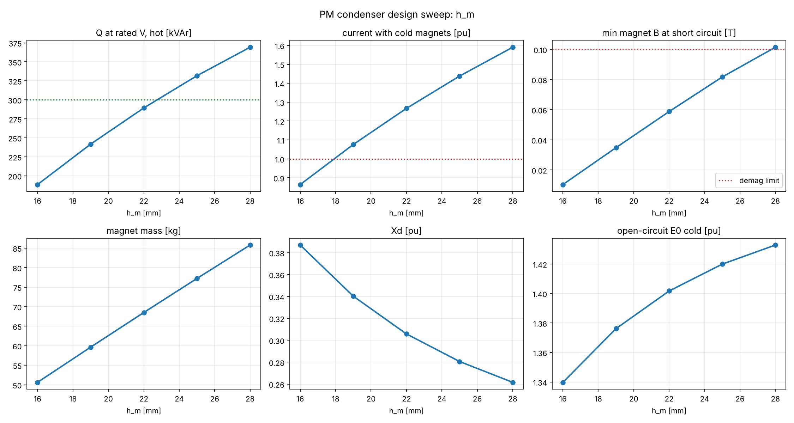

# PM condenser sweep: h_m

| value | h_m_mm | alpha_p | gap_mm | E0_pu | Xd_pu | Q_kVAr | Q_cold_kVAr | I_cold_pu | dQ_per_pct | I_sc_pu | Bd_min_sc | magnet_kg | B_tooth_T | P_loss_kW |
|---|---|---|---|---|---|---|---|---|---|---|---|---|---|---|
| 0.016 | 16.0 | 0.792 | 3.5 | 1.255 | 0.387 | 189 | 259 | 0.86 | -5.4 | 3.04 | 0.01 | 50.6 | 1.51 | 2.34 |
| 0.019 | 19.0 | 0.792 | 3.5 | 1.291 | 0.340 | 242 | 323 | 1.08 | -5.7 | 3.49 | 0.03 | 59.6 | 1.56 | 3.04 |
| 0.022 | 22.0 | 0.792 | 3.5 | 1.317 | 0.306 | 289 | 380 | 1.27 | -6.0 | 3.91 | 0.06 | 68.5 | 1.59 | 3.78 |
| 0.025 | 25.0 | 0.792 | 3.5 | 1.334 | 0.281 | 332 | 432 | 1.44 | -6.3 | 4.29 | 0.08 | 77.2 | 1.61 | 4.53 |
| 0.028 | 28.0 | 0.792 | 3.5 | 1.347 | 0.262 | 369 | 477 | 1.59 | -6.6 | 4.65 | 0.10 | 85.8 | 1.63 | 5.26 |

