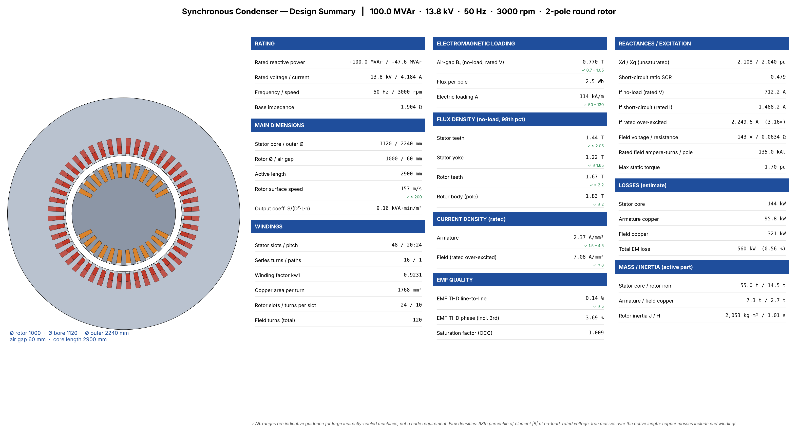
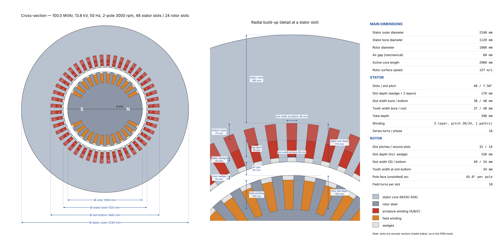
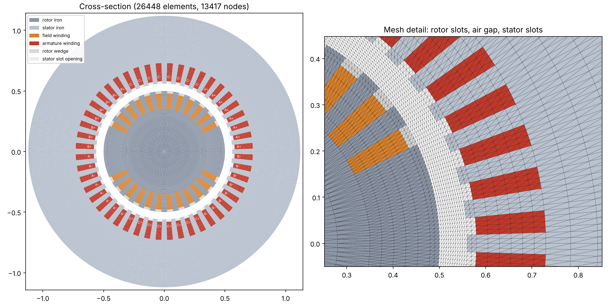
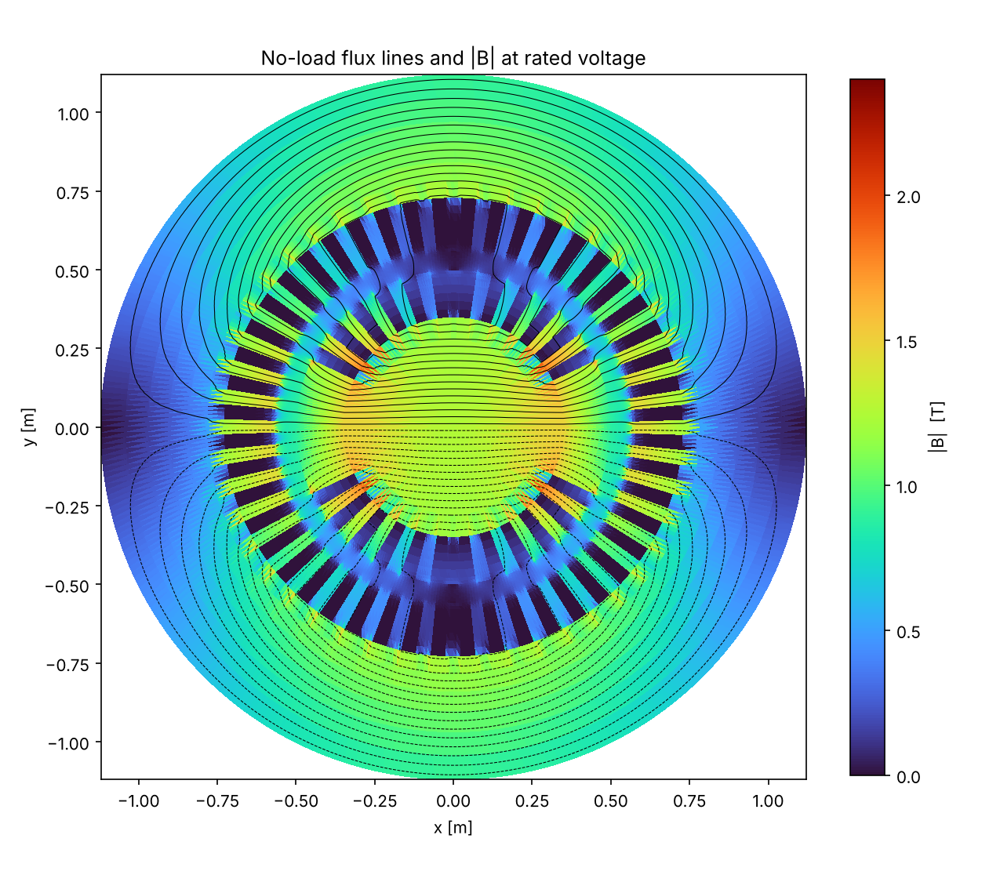
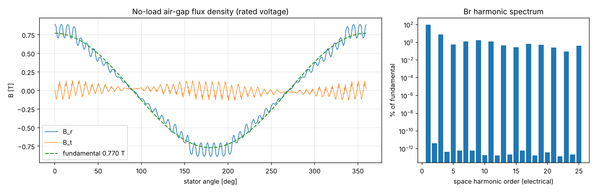
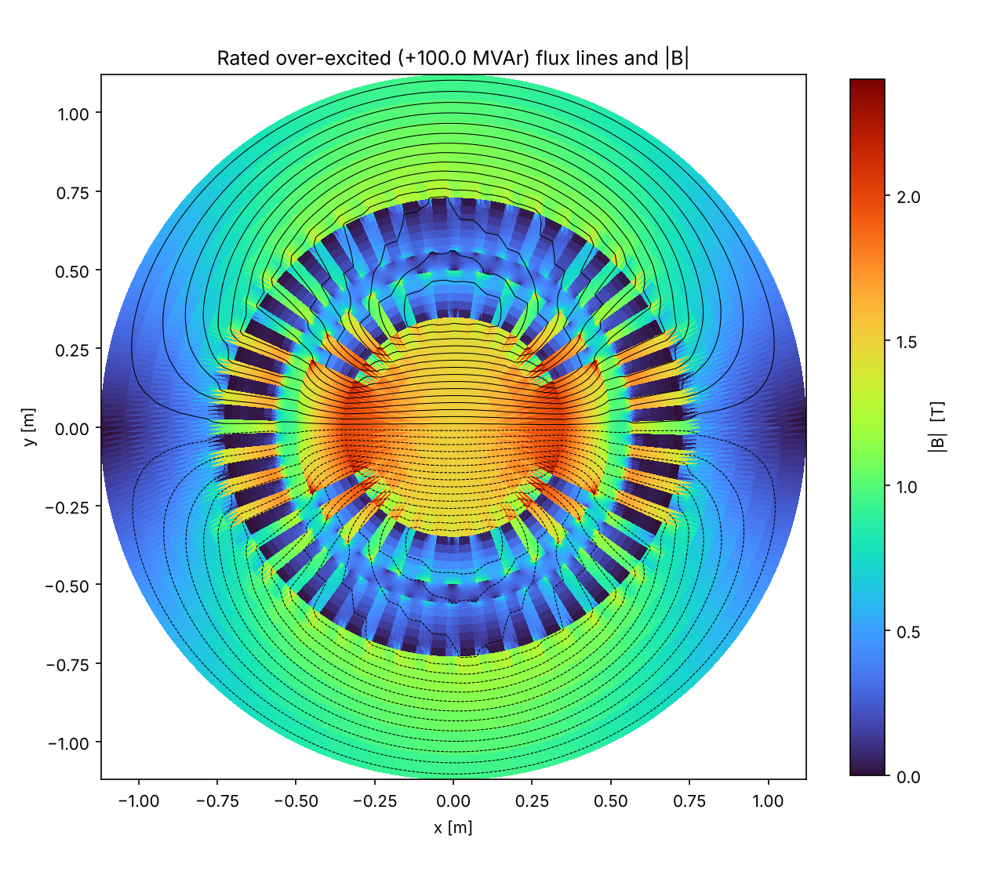
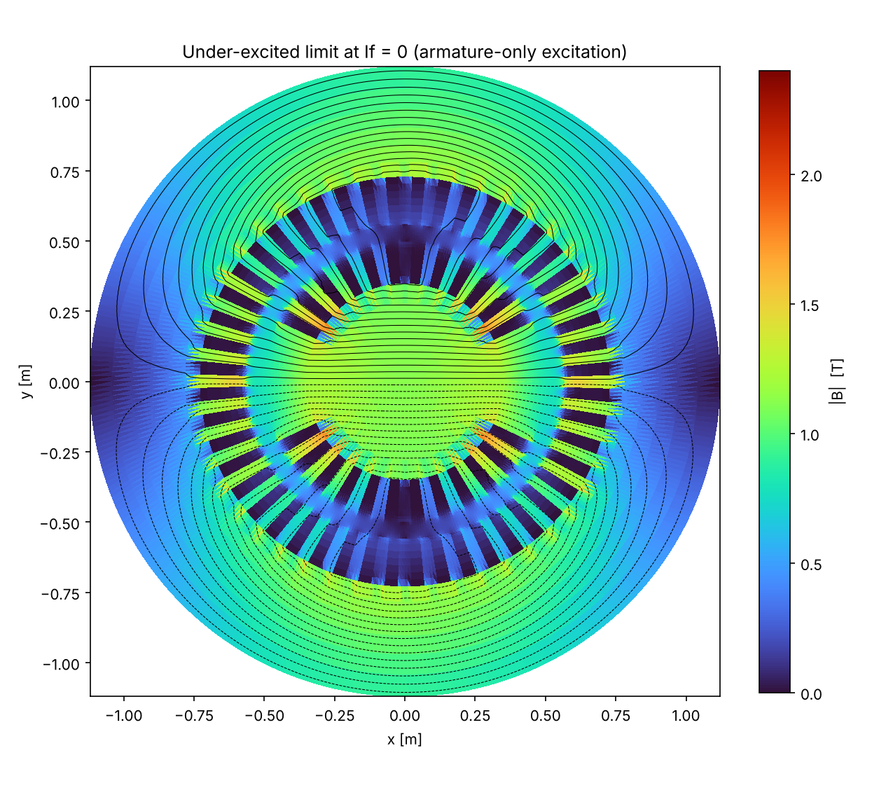
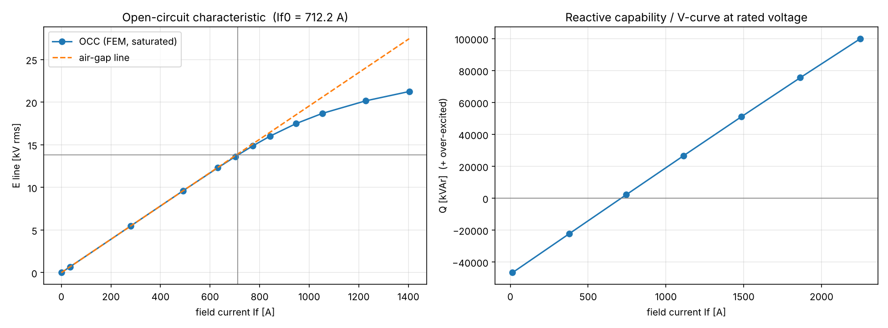
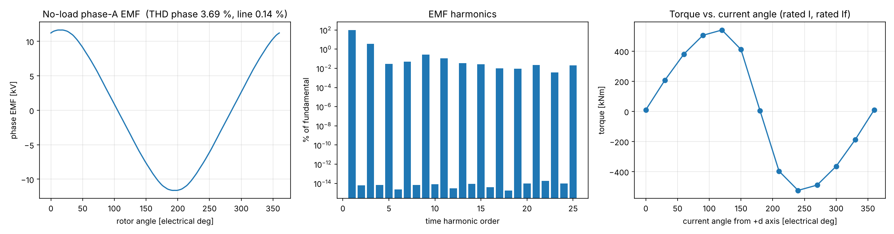

# Synchronous Condenser — 2-D Electromagnetic FEM Study

Machine: **100.0 MVAr, 13.8 kV, 50 Hz, 2-pole, 3000 rpm**, round (cylindrical) rotor with distributed field winding.
Nonlinear magnetostatic Az FEM, first-order triangles, Newton–Raphson, sliding air-gap interface.
Mesh: 26448 elements / 13417 nodes. Runtime 292 s.

## 1. Main dimensions

| Item | Value |
|---|---|
| Rotor diameter | 1000 mm |
| Air gap (mechanical) | 60 mm |
| Stator bore / outer diameter | 1120 / 2240 mm |
| Active length | 2.90 m |
| Stator slots / coil pitch | 48 / 20 slots (full pitch 24) |
| Armature winding | double layer, 1 parallel paths, 16 series turns/phase, kw1 = 0.9231 |
| Rotor slots | 24 wound of 32 pitches, 10 turns/slot |
| Rotor peripheral speed | 157 m/s |

## 2. No-load / open circuit

| Result | Value |
|---|---|
| Field current for rated voltage, If0 | **712.2 A** |
| Field current on the air-gap line | 705.8 A |
| Saturation factor If0/If,ag | 1.009 |
| Air-gap Br fundamental | 0.770 T |
| EMF fundamental (rotation sweep) | 13.802 kV line |
| EMF THD line-to-line / phase | 0.14 % / 3.69 % (triplen harmonics cancel line-to-line) |
| Peak no-load cogging torque | 2.6e+03 Nm |

## 3. Reactances and short-circuit ratio

| Parameter | Value |
|---|---|
| Xd (unsaturated, incl. end leakage 0.06 pu) | **2.108 pu** |
| Xq (unsaturated) | 2.040 pu |
| Field current for rated armature current on short circuit, If,sc | 1488.2 A |
| Short-circuit ratio SCR = If0/If,sc | **0.479** |

## 4. Reactive capability

| Operating point | Value |
|---|---|
| Rated over-excited Q | +100.0 MVAr at I = 4184 A |
| Rated field current (over-excited) | **2249.6 A** (3.16 × If0) |
| Under-excited capability at If = 0 | -47.6 MVAr (I = 1992 A) |
| Air-gap torque at rated over-excited point | 4.6e+03 Nm (≈ 0: no active power) |
| Max static torque at rated I, rated If | 1.70 pu (Tbase = 318,310 Nm) |

## 5. Losses (estimate)

| Loss component | Value |
|---|---|
| Stator core (Steinmetz, build factor 1.5) | 144 kW (core mass 55,029 kg) |
| Armature copper, Rph = 1.82 mΩ | 95.8 kW (J = 2.4 A/mm²) |
| Field copper, Rf = 0.0634 Ω, Uf = 143 V | 321 kW (J = 7.1 A/mm²) |
| **Total electromagnetic loss** | **560 kW (0.56 % of rating)** |

Friction, windage, bearing, and stray-load losses are not included.

## 6. Modelling assumptions

* 2-D magnetostatic analysis per unit length × active length; end-winding leakage is added as a fixed reactance (Xend = 0.06 pu); end-region fields, axial ducts, and stacking factor are neglected in the field solution.
* Slots are modelled as annular sectors (radial sides) on a structured polar mesh; slot openings and wedges are non-magnetic.
* Rotor body: solid steel B–H curve. Stator: M330-50A-class lamination. No eddy currents (magnetostatic).
* Purely reactive operation: armature MMF on the d-axis (−d over-excited, +d under-excited); armature resistance is neglected for voltage.
* Losses: Steinmetz iron loss using the peak element flux density from the rotation sweep; copper at 75 °C.
