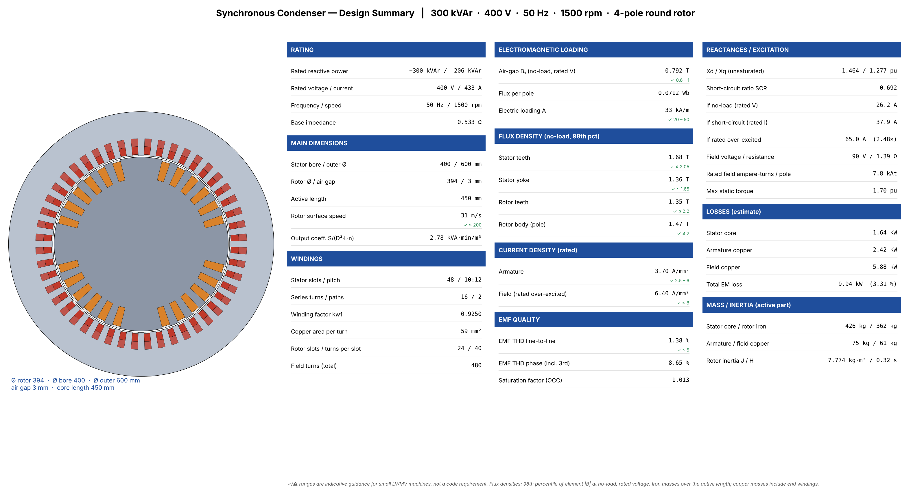
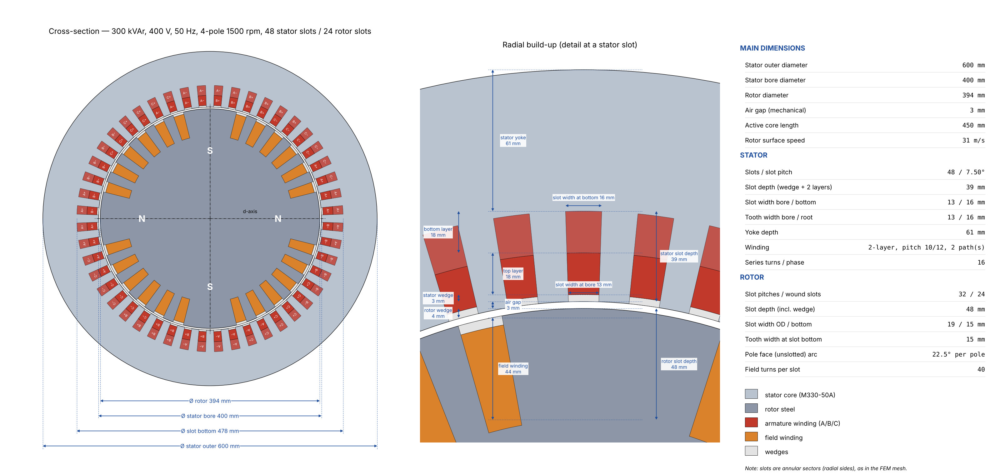
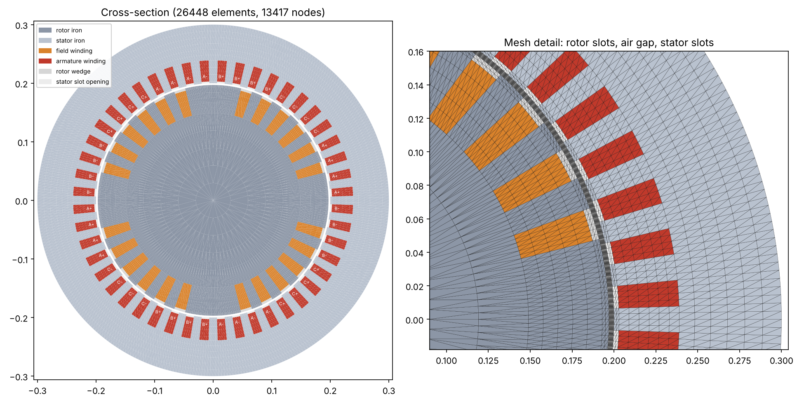
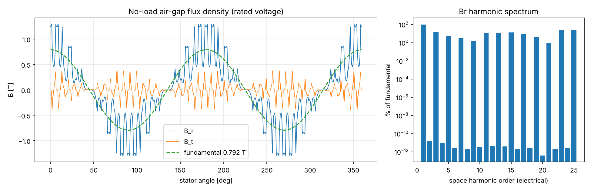
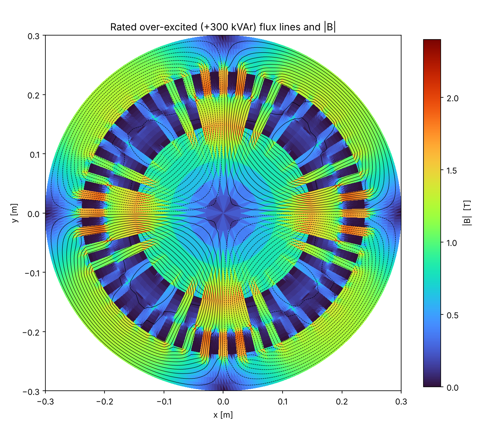
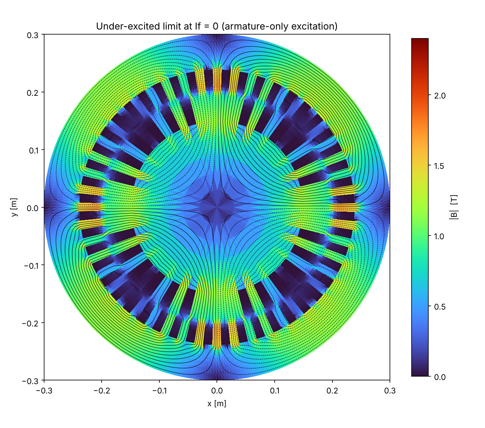
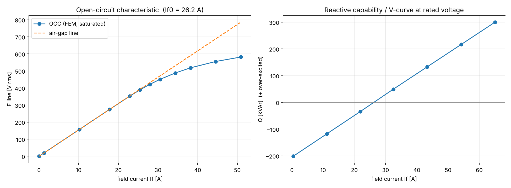
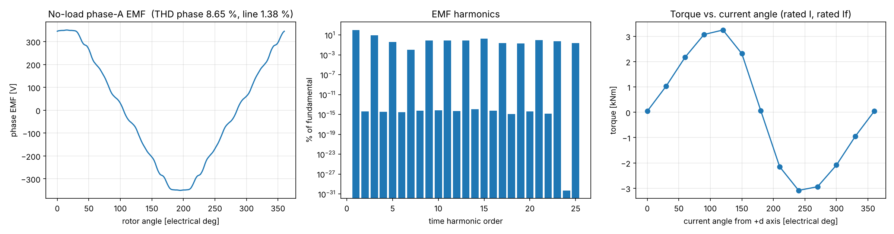

# Synchronous Condenser — 2-D Electromagnetic FEM Study

Machine: **300 kVAr, 400 V, 50 Hz, 4-pole, 1500 rpm**, round (cylindrical) rotor with distributed field winding.
Nonlinear magnetostatic Az FEM, first-order triangles, Newton–Raphson, sliding air-gap interface.
Mesh: 26448 elements / 13417 nodes. Runtime 291 s.

## 1. Main dimensions

| Item | Value |
|---|---|
| Rotor diameter | 394 mm |
| Air gap (mechanical) | 3 mm |
| Stator bore / outer diameter | 400 / 600 mm |
| Active length | 0.45 m |
| Stator slots / coil pitch | 48 / 10 slots (full pitch 12) |
| Armature winding | double layer, 2 parallel paths, 16 series turns/phase, kw1 = 0.9250 |
| Rotor slots | 24 wound of 32 pitches, 40 turns/slot |
| Rotor peripheral speed | 31 m/s |

## 2. No-load / open circuit

| Result | Value |
|---|---|
| Field current for rated voltage, If0 | **26.2 A** |
| Field current on the air-gap line | 25.9 A |
| Saturation factor If0/If,ag | 1.013 |
| Air-gap Br fundamental | 0.792 T |
| EMF fundamental (rotation sweep) | 401 V line |
| EMF THD line-to-line / phase | 1.38 % / 8.65 % (triplen harmonics cancel line-to-line) |
| Peak no-load cogging torque | 104 Nm |

## 3. Reactances and short-circuit ratio

| Parameter | Value |
|---|---|
| Xd (unsaturated, incl. end leakage 0.06 pu) | **1.464 pu** |
| Xq (unsaturated) | 1.277 pu |
| Field current for rated armature current on short circuit, If,sc | 37.9 A |
| Short-circuit ratio SCR = If0/If,sc | **0.692** |

## 4. Reactive capability

| Operating point | Value |
|---|---|
| Rated over-excited Q | +300 kVAr at I = 433 A |
| Rated field current (over-excited) | **65.0 A** (2.48 × If0) |
| Under-excited capability at If = 0 | -206 kVAr (I = 297 A) |
| Air-gap torque at rated over-excited point | 63.1 Nm (≈ 0: no active power) |
| Max static torque at rated I, rated If | 1.70 pu (Tbase = 1,910 Nm) |

## 5. Losses (estimate)

| Loss component | Value |
|---|---|
| Stator core (Steinmetz, build factor 1.5) | 1.64 kW (core mass 426 kg) |
| Armature copper, Rph = 4.30 mΩ | 2.42 kW (J = 3.7 A/mm²) |
| Field copper, Rf = 1.39 Ω, Uf = 90 V | 5.88 kW (J = 6.4 A/mm²) |
| **Total electromagnetic loss** | **9.94 kW (3.31 % of rating)** |

Friction, windage, bearing, and stray-load losses are not included.

## 6. Modelling assumptions

* 2-D magnetostatic analysis per unit length × active length; end-winding leakage is added as a fixed reactance (Xend = 0.06 pu); end-region fields, axial ducts, and stacking factor are neglected in the field solution.
* Slots are modelled as annular sectors (radial sides) on a structured polar mesh; slot openings and wedges are non-magnetic.
* Rotor body: solid steel B–H curve. Stator: M330-50A-class lamination. No eddy currents (magnetostatic).
* Purely reactive operation: armature MMF on the d-axis (−d over-excited, +d under-excited); armature resistance is neglected for voltage.
* Losses: Steinmetz iron loss using the peak element flux density from the rotation sweep; copper at 75 °C.
