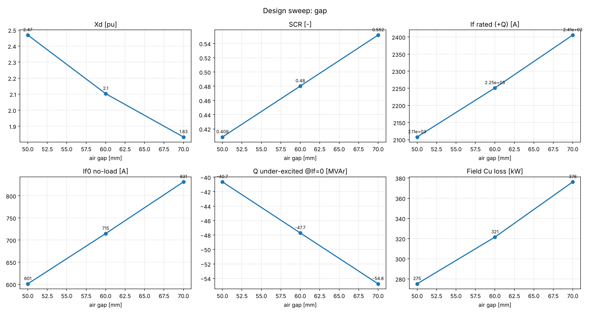

# Design sweep: gap

Mesh preset: normal. Stator bore kept fixed; rotor diameter = bore − 2·gap.

| value | R_rotor_mm | gap_mm | If0_A | If_sc_A | If_rated_A | Xd_pu | Xq_pu | SCR | Q_under_If0_MVAr | Q_under_pct | B_gap1_T | sat_factor | P_field_kW | U_field_V | J_field_A_mm2 | B_tooth_max_T | B_rotor_body_max_T |
|---|---|---|---|---|---|---|---|---|---|---|---|---|---|---|---|---|---|
| 0.05 | 510 | 50 | 601 | 1471 | 2108 | 2.469 | 2.372 | 0.409 | -40.7 | 41 | 0.768 | 1.009 | 275 | 131 | 6.48 | 1.45 | 1.79 |
| 0.06 | 500 | 60 | 715 | 1488 | 2251 | 2.103 | 2.033 | 0.480 | -47.7 | 48 | 0.771 | 1.010 | 321 | 143 | 7.08 | 1.44 | 1.84 |
| 0.07 | 490 | 70 | 831 | 1507 | 2406 | 1.833 | 1.780 | 0.552 | -54.8 | 55 | 0.775 | 1.012 | 376 | 156 | 7.76 | 1.43 | 1.87 |

