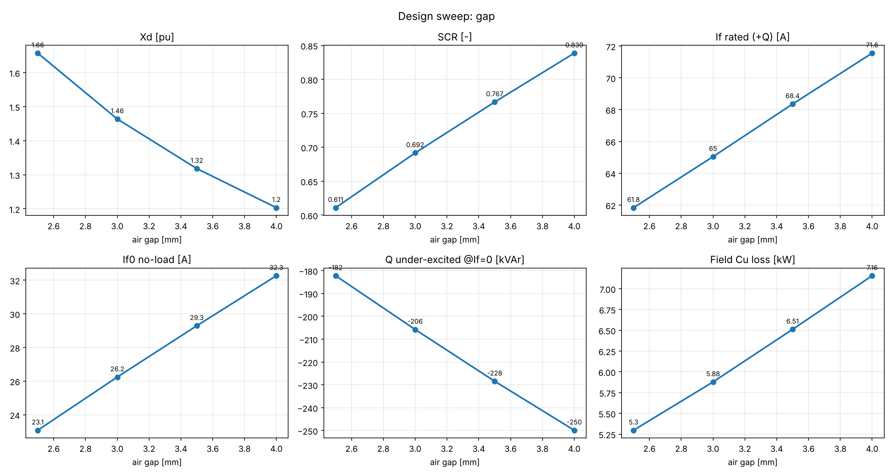

# Design sweep (factory300): gap

Mesh preset: normal. Stator bore kept fixed; rotor diameter = bore − 2·gap.

| value | R_rotor_mm | gap_mm | If0_A | If_sc_A | If_rated_A | Xd_pu | Xq_pu | SCR | Q_under_If0_kVAr | Q_under_pct | B_gap1_T | sat_factor | P_field_kW | P_total_kW | J_arm_A_mm2 | U_field_V | J_field_A_mm2 | B_tooth_max_T | B_rotor_body_max_T |
|---|---|---|---|---|---|---|---|---|---|---|---|---|---|---|---|---|---|---|---|
| 0.0025 | 197.5 | 2.5 | 23.1 | 37.8 | 61.8 | 1.657 | 1.427 | 0.611 | -182.2 | 61 | 0.792 | 1.016 | 5.3 | 8.59 | 3.70 | 86 | 6.07 | 1.70 | 1.46 |
| 0.003 | 197.0 | 3.0 | 26.2 | 37.9 | 65.0 | 1.464 | 1.277 | 0.692 | -205.8 | 69 | 0.792 | 1.013 | 5.88 | 9.16 | 3.70 | 90 | 6.40 | 1.68 | 1.47 |
| 0.0035 | 196.5 | 3.5 | 29.3 | 38.2 | 68.4 | 1.318 | 1.163 | 0.767 | -228.4 | 76 | 0.790 | 1.011 | 6.51 | 9.79 | 3.70 | 95 | 6.75 | 1.66 | 1.47 |
| 0.004 | 196.0 | 4.0 | 32.3 | 38.5 | 71.6 | 1.203 | 1.071 | 0.839 | -249.9 | 83 | 0.793 | 1.010 | 7.16 | 10.4 | 3.70 | 100 | 7.09 | 1.65 | 1.48 |

